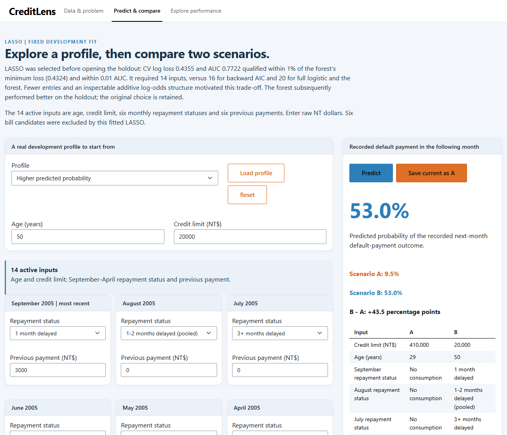
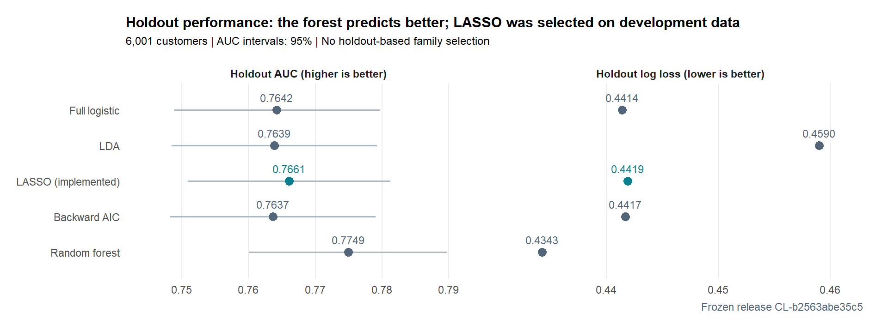

# CreditLens

**Predicting next-month credit-card payment default, with transparent model validation and an interactive Shiny app.**

CreditLens estimates the probability of the supplier-defined default outcome for customers in a historical Taiwanese credit-card dataset. It uses April–September 2005 payment histories to predict the following month. The app lets users inspect a profile, compare scenarios and see how a classification threshold changes missed defaults and false alarms.

**[Open the live Shiny app](https://pimvdb.shinyapps.io/creditlens/)** · **[Read the report](submission/individual_assignment.pdf)** · [Explore the R implementation](submission/CreditLens.R)



*Actual hosted application. The lower-probability profile is saved as A; the higher-probability profile is B. These are model-based comparisons, not causal effects.*

An individual academic project by **Pim van den Bos**, demonstrating statistical modeling, credit-risk analysis, model validation, reproducibility and communication of probabilistic predictions. It is an educational retail-credit project, not a production lending system or counterparty-exposure model, and was not completed for a bank.

## Results at a glance

Development used 23,999 customers and shared stratified **nested 5 × 5 cross-validation**. The final holdout contained **6,001 customers**, including 1,328 observed defaults. Family selection was locked before holdout evaluation.

| Model | Development CV AUC ↑ | Development CV log loss ↓ | Holdout AUC ↑ | Holdout log loss ↓ | Holdout Brier ↓ | Final inputs |
|:--|--:|--:|--:|--:|--:|--:|
| Full logistic regression | 0.7733 | 0.4330 | 0.7642 | 0.4414 | 0.1384 | 20 |
| LDA | 0.7737 | 0.4483 | 0.7639 | 0.4590 | 0.1426 | 20 |
| **LASSO logistic — implemented** | **0.7722** | **0.4355** | **0.7661** | **0.4419** | **0.1389** | **14** |
| Backward-AIC logistic | 0.7728 | 0.4333 | 0.7637 | 0.4417 | 0.1385 | 16 |
| Probability random forest | 0.7740 | 0.4324 | 0.7749 | 0.4343 | 0.1364 | 20 |

AUC measures ranking discrimination; **0.77 AUC is not 77% accuracy**. Log loss and Brier score assess probability predictions; lower is better.



*Computed from the packaged holdout results. Intervals describe each fitted model's AUC; their overlap is not a test of equal performance.*

### Why implement LASSO?

The prespecified family-selection rule first found the lowest development CV log loss: **0.4324 for the forest**. Eligible models needed log loss no more than **1% above that minimum** and AUC no more than **0.01 below the minimum-loss family's AUC**. Among eligible models, the rule chose the fewest required original inputs. LASSO qualified and needed **14**, compared with **16** for backward AIC and **20** for full logistic regression and the forest.

This trades a small development-performance difference for fewer fields to enter and an inspectable additive log-odds structure. Fewer inputs do not guarantee better generalization. Separately, LASSO's **one-SE tuning rule** chose a stronger penalty whose estimated tuning performance remained within one fold-based standard-error allowance of the minimum. Penalty tuning and family selection are different decisions.

The forest subsequently performed better on all three holdout measures. Its paired AUC advantage over LASSO was **0.0088 (95% CI 0.0003–0.0174)**. LASSO remains implemented because the development-based selection rule was already fixed; the models were not shown to be equivalent.

At threshold **0.50**, LASSO identifies **416** defaults, misses **912**, raises **215** false alarms and correctly leaves **4,458** nondefaults unflagged. It misses **68.7% of observed defaults**. Lower thresholds increase sensitivity at the cost of more false alarms; accuracy alone conceals this trade-off.

## From data to app

1. **Prepare:** audit the exact 30,000-row source, create a stratified development/holdout split, and learn preprocessing inside training folds.
2. **Develop:** compare full logistic regression, LDA, LASSO, backward AIC and a probability forest. Tune LASSO and the forest within nested CV.
3. **Validate:** assess discrimination, probability loss, calibration and paired holdout differences; use 200 backward-selection bootstrap replications for optimism and inclusion frequencies.
4. **Select:** apply the locked development-performance/input-count rule; fit the selected LASSO on development data only.
5. **Communicate:** serve the frozen fit in Shiny, with readable validation, extrapolation notices, scenario changes and threshold exploration. Startup never trains or installs packages.

The 20 candidate inputs are age, credit limit and six monthly values each for repayment status, bill amount and previous payment. The final LASSO uses **age, credit limit, all six repayment statuses and all six previous payments**; the six bill amounts have zero final coefficients. Sex, education and marital status were excluded from the candidates. This exclusion does not establish fairness.

See [technical notes](docs/technical-notes.md) for preprocessing, diagnostics, coefficient inspection and the distinction between permutation importance, backward-selection stability and final LASSO coefficients.

## Run locally

Use **R ≥ 4.5**; the release was tested with **R 4.5.3**. Install the app/verification dependencies explicitly in R:

```r
install.packages(c(
  "shiny", "bslib", "htmltools", "ggplot2", "glmnet", "Matrix",
  "pROC", "digest", "base64enc"
))
```

From the repository root, launch the app:

```r
source("submission/CreditLens.R")
creditlens("app")
```

Or run `Rscript submission/CreditLens.R app` and open `http://127.0.0.1:3838`.

Run the frozen-release checks and repository checks:

```sh
Rscript submission/CreditLens.R verify
Rscript scripts/verify.R
```

To render the report, install `rmarkdown` and `knitr`, **Pandoc ≥ 2** and a working **LaTeX distribution**, such as TinyTeX. RStudio normally discovers Pandoc; a terminal can use Pandoc on PATH or its own `RSTUDIO_PANDOC` setting. Then:

```r
source("submission/CreditLens.R")
creditlens("report")
```

The frozen app and report require **no raw data or original development folders**. The canonical [submission/](submission/) directory contains exactly the R source, saved assets, Rmd and PDF; copying those four together is sufficient with installed dependencies. [Tested package versions and verification scope](docs/reproducibility.md) are documented separately. The PDF has six narrative pages plus a code appendix.

Files: [report PDF](submission/individual_assignment.pdf) · [report Rmd](submission/individual_assignment.Rmd) · [main R implementation](submission/CreditLens.R) · [saved model and assets](submission/creditlens_assets.rds).

### Rebuild the analysis separately

Rebuilding is expensive and requires the **exact original CSV**, plus `MASS`, `ranger`, `jsonlite` and `readxl`. It reruns nested CV and the 200-replicate bootstrap; routine CI does neither. Follow the [data source, checksum and rebuild instructions](docs/data-and-licensing.md). No refitting was done to prepare this portfolio.

## Limitations

- The sample is historical and geographically limited. Validation is internal, without a later-period or external population test.
- The supplier's binary outcome has no day-count definition here; it is not evidence of regulatory PD compliance or a current credit-approval policy.
- Correlated payment histories, sparse severe-delay groups and model assumptions affect interpretation. Nominal status effects are unconstrained: a higher delay category need not produce a higher fitted probability.
- Scenario differences and penalized coefficients are associations, not causal intervention effects. Point estimates near ideal calibration do not establish perfect calibration.
- Costs, deployment drift, external calibration and subgroup fairness would need further assessment before any lending-policy use.

## Data, references and licenses

Data: Yeh, I. (2009), [Default of Credit Card Clients, UCI Machine Learning Repository](https://doi.org/10.24432/C55S3H), **CC BY 4.0**. The supplied Kaggle CSV was checked against the original UCI workbook. Raw data are not bundled. See [data attribution and license scope](docs/data-and-licensing.md).

Methodological references include [Friedman, Hastie & Tibshirani on glmnet](https://doi.org/10.18637/jss.v033.i01), [Breiman on random forests](https://doi.org/10.1023/A:1010933404324) and [DeLong et al. on paired AUC comparisons](https://doi.org/10.2307/2531595). Expanded repayment-code labels follow [Chen & Ye (2022), §4.1.1](https://arxiv.org/pdf/2209.10070) and the [H2O.ai tutorial](https://h2oai.github.io/tutorials/machine-learning-interpretability/); the abbreviated UCI description omits some codes.

Original software and portfolio documentation are [MIT licensed](LICENSE). Dataset-derived records and the academic report have separate terms described in [NOTICE.md](NOTICE.md).
